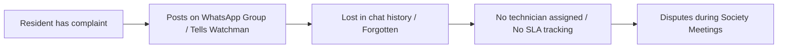
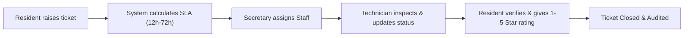

# Chapter 1: Preliminary Investigation

---

## 1.1 Problem Identification
In cooperative housing societies (CHS) and residential complexes across urban India, operational administration is traditionally managed through manual paper registers or ad-hoc WhatsApp groups. These informal communication channels introduce severe operational inefficiencies:
1. **Unstructured Grievance Lodging**: Maintenance complaints (such as plumbing leaks, elevator failures, corridor electrical trips, or parking encroachments) get lost under casual chat conversations.
2. **Absence of Accountability and SLA Enforcement**: There is no systematic mechanism to track Service Level Agreements (SLAs), leading to prolonged delays in attending to emergency breakdowns.
3. **Opaque Maintenance Accounting**: Society dues are tracked on paper notebooks or isolated personal Excel files. Residents lack real-time visibility into their dues and historical payment receipts, leading to disputes during Annual General Body Meetings (AGMs).
4. **Scattered Announcements**: Critical circulars (e.g., water disruption schedules, statutory AGM notices) are overlooked without any verification of resident read receipts.

---

## 1.2 Problem Statement
*"To design and develop a web-based, role-governed housing society management portal ('NivasSetu') that centralizes grievance lifecycle tracking with dynamic SLA enforcement, formalizes staff assignment, provides transparent maintenance billing with printable vouchers, and delivers an immutable audit trail for complete society accountability."*

---

## 1.3 Existing System & Limitations

### Limitations of the Existing System:
- **No Traceability**: Zero chronological record of who reported the issue, when work started, or technician progress notes.
- **No Reopen Protection**: Residents cannot formally dispute an unsatisfactory repair.
- **Manual Billing Errors**: Dues calculation based on carpet area (sq.ft) and fixed funds is computed manually, prone to calculation errors.
- **Lack of Central Audit**: Financial payments (Cash/UPI/Cheque) lack instant verification receipts.

---

## 1.4 Proposed System (NivasSetu)

NivasSetu provides:
1. **Role-Based Access Control (RBAC)**: Distinct, isolated views for Secretary (Admin), Residents (Owners/Tenants), and Staff Technicians.
2. **Transparent Ticket State Machine**: `OPEN` $\rightarrow$ `ASSIGNED` $\rightarrow$ `IN_PROGRESS` $\rightarrow$ `RESOLVED` $\rightarrow$ `CLOSED`, with a strict 7-day resident reopen window.
3. **Automated Maintenance Ledger**: Automated monthly billing per flat, multi-mode payment recording (Cash, UPI UTR, Cheque), and instant print-ready receipts.
4. **Notice Board with Read Acknowledgements**: Pinned notices with resident read-receipts.
5. **Real-Time Analytics & CSV Export**: Performance metrics and CSV data downloads.

---

## 1.5 Objectives of the Project
- **Objective 1**: Develop a normalized (3NF) relational database to model housing society assets, units, residents, tickets, and payments.
- **Objective 2**: Implement a grievance lifecycle workflow with dynamic SLA computation based on issue severity (Urgent 12h, High 24h, Medium 48h, Low 72h).
- **Objective 3**: Provide automated maintenance billing calculating dues based on carpet area tariffs and fixed sinking funds.
- **Objective 4**: Enable multi-mode payment recording and generate print-friendly vouchers.
- **Objective 5**: Guarantee resident data privacy by isolating grievance and payment visibility exclusively to the occupying flat owner/tenant.
- **Objective 6**: Deliver an immutable audit log and management analytics dashboard with visual graphs and CSV export capabilities.

---

## 1.6 Feasibility Study

| Feasibility Dimension | Analysis & Findings | Conclusion |
|---|---|---|
| **Technical Feasibility** | Built using modern Python (Django 5/6), standard HTML5, Tailwind CSS, HTMX, and SQLite/PostgreSQL. Requires standard server runtime without proprietary licenses. | **Highly Feasible** |
| **Operational Feasibility** | Intuitive mobile-first design system with bottom navigation bar. Accessible to residents across all age groups without technical training. | **Highly Feasible** |
| **Economic Feasibility** | Built entirely on open-source technologies (MIT, BSD, PSF licenses). Eliminates third-party software subscription fees. | **Economically Viable** |
| **Schedule Feasibility** | Modularized into 7 distinct stages, implemented and verified within the academic semester timeframe. | **On Schedule** |

---

## 1.7 Scope and Limitations

### Scope
- Covers cooperative housing societies and apartment associations.
- Handles flats, wings, ownership/tenancy contracts, and staff specialties.
- Enforces complaint resolution timelines and resident satisfaction feedback.
- Automates billing calculations, receipt generation, and circular broadcasts.

### Limitations
- Does not integrate external SMS gateways (uses on-screen notifications and notice board).
- Does not process live online banking payment gateways (recording of UPI/Cheque/Cash is verified manually by the secretary).
- Assumes society administrative jurisdiction within India (currency formatted in INR).

---

## 1.8 Stakeholder Interview Notes
> *[Placeholders for Real Interview Findings from Housing Society Office Bearers]*
- **Interviewee 1 (Society Secretary)**: *"Tracking who paid maintenance on UPI and matching it with bank statements takes hours every month. A printable receipt generator and pending list is our top priority."*
- **Interviewee 2 (Resident / Flat Owner)**: *"Plumbing issues in common pipes are ignored because nobody takes responsibility. We need a ticket system where overdue issues are visibly flagged."*
- **Interviewee 3 (Maintenance Electrician)**: *"We need a simple mobile view showing our daily assigned repair tasks without clutter."*

