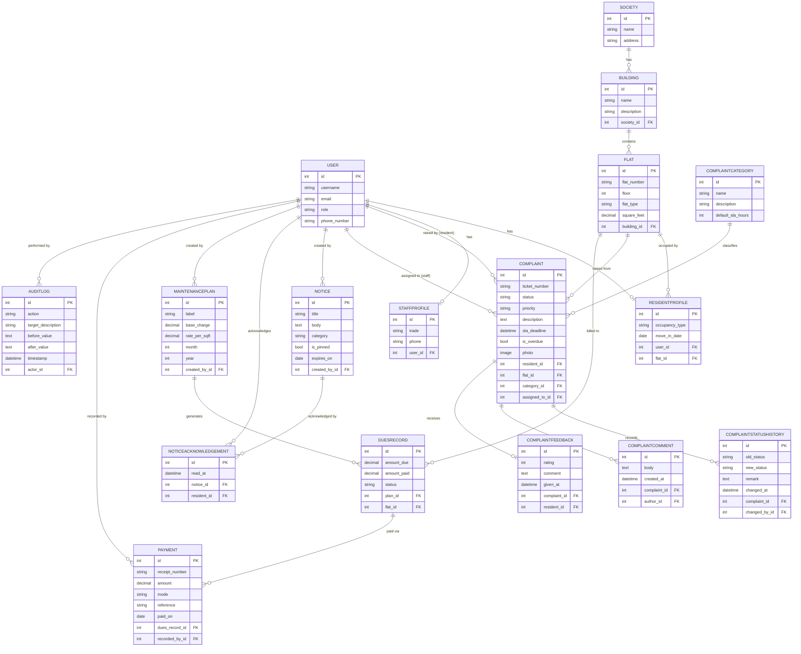

# Chapter 3 — Database Design

**Project:** NivasSetu  **Version:** 1.0

---

## 3.1 Entity Identification

| Entity | Justification |
|--------|--------------|
| **User** | Central authentication entity; extended with role and phone. |
| **Society** | Represents the housing complex; parent of all master data. |
| **Building** | A wing/block of the society (e.g., Wing A). |
| **Flat** | Individual unit within a building; linked to residents. |
| **ResidentProfile** | Maps a User (role=RESIDENT) to a Flat with occupancy type. |
| **StaffProfile** | Maps a User (role=STAFF) to a trade and phone number. |
| **ComplaintCategory** | Lookup table for complaint types (Electrical, Plumbing…). |
| **Complaint** | Core ticket entity; holds status, priority, SLA deadline. |
| **ComplaintStatusHistory** | Audit of every status transition on a Complaint. |
| **ComplaintComment** | Discussion thread entries on a Complaint. |
| **ComplaintFeedback** | Post-resolution rating given by the Resident. |
| **Notice** | Announcements published by the Secretary. |
| **NoticeAcknowledgement** | Records which Resident has read which Notice. |
| **MaintenancePlan** | Defines the charge formula for a billing period. |
| **DuesRecord** | Calculated due for a specific Flat in a specific period. |
| **Payment** | Manual payment against a DuesRecord with receipt number. |
| **AuditLog** | Immutable log of significant actions across all modules. |

---

## 3.2 ER Diagram (Mermaid)



---

## 3.3 Relationship Descriptions

| Relationship | Cardinality | Description |
|-------------|-------------|-------------|
| Society → Building | 1 : N | A society has many buildings/wings |
| Building → Flat | 1 : N | A building has many flats |
| User → ResidentProfile | 1 : 1 | Each resident user has one profile |
| User → StaffProfile | 1 : 1 | Each staff user has one profile |
| Flat → ResidentProfile | 1 : N | A flat can have successive residents over time |
| Flat → Complaint | 1 : N | A flat can have many complaints |
| User → Complaint (resident) | 1 : N | A resident can raise many complaints |
| User → Complaint (staff) | 1 : N | A staff member can be assigned many complaints |
| ComplaintCategory → Complaint | 1 : N | Each complaint belongs to one category |
| Complaint → ComplaintStatusHistory | 1 : N | Each status change is one history row |
| Complaint → ComplaintComment | 1 : N | Each complaint has a discussion thread |
| Complaint → ComplaintFeedback | 1 : 1 | At most one feedback per complaint |
| Notice → NoticeAcknowledgement | 1 : N | Multiple residents acknowledge the same notice |
| MaintenancePlan → DuesRecord | 1 : N | One plan generates one record per flat |
| DuesRecord → Payment | 1 : N | Partial payments allowed; each payment is one row |

---

## 3.4 Relational Schema

```
User(id PK, username UNIQUE, email, password_hash, role, phone_number, is_active)

Society(id PK, name, address, created_at)

Building(id PK, name, description, society_id FK→Society)

Flat(id PK, flat_number, floor, flat_type, square_feet, building_id FK→Building,
     UNIQUE(flat_number, building_id))

ResidentProfile(id PK, user_id FK→User UNIQUE, flat_id FK→Flat,
                occupancy_type, move_in_date)

StaffProfile(id PK, user_id FK→User UNIQUE, trade, phone)

ComplaintCategory(id PK, name UNIQUE, description, default_sla_hours)

Complaint(id PK, ticket_number UNIQUE, status, priority, description,
          photo, sla_deadline, created_at, updated_at,
          resident_id FK→User, flat_id FK→Flat,
          category_id FK→ComplaintCategory,
          assigned_to_id FK→User NULL)

ComplaintStatusHistory(id PK, complaint_id FK→Complaint, changed_by_id FK→User,
                       old_status, new_status, remark, changed_at)

ComplaintComment(id PK, complaint_id FK→Complaint, author_id FK→User,
                 body, created_at)

ComplaintFeedback(id PK, complaint_id FK→Complaint UNIQUE,
                  resident_id FK→User, rating, comment, given_at)

Notice(id PK, title, body, category, is_pinned, expires_on,
       created_by_id FK→User, created_at)

NoticeAcknowledgement(id PK, notice_id FK→Notice, resident_id FK→User,
                      read_at, UNIQUE(notice_id, resident_id))

MaintenancePlan(id PK, label, base_charge, rate_per_sqft, month, year,
                created_by_id FK→User, created_at,
                UNIQUE(month, year))

DuesRecord(id PK, plan_id FK→MaintenancePlan, flat_id FK→Flat,
           amount_due, amount_paid DEFAULT 0, status,
           UNIQUE(plan_id, flat_id))

Payment(id PK, dues_record_id FK→DuesRecord, receipt_number UNIQUE,
        amount, mode, reference, paid_on,
        recorded_by_id FK→User, created_at)

AuditLog(id PK, actor_id FK→User, action, target_description,
         before_value, after_value, timestamp)
```

---

## 3.5 Normalization — Worked Example (DuesRecord)

### 3.5.1 Unnormalized Form (UNF)
Imagine storing all dues data in a single table:

```
DuesFlat(flat_number, building_name, resident_name, month, year,
         base_charge, rate_per_sqft, area, amount_due,
         amount_paid, receipt_number, payment_mode, payment_date)
```

**Problems:** Repeating groups (multiple payments per flat per month), data redundancy (building name repeated for every row).

### 3.5.2 First Normal Form (1NF)
*Rule: Atomic values, no repeating groups, each row uniquely identified.*

Separate the payment rows so each cell contains one value:

```
DuesFlat(dues_id PK, flat_number, building_name, resident_name, month, year,
         base_charge, rate_per_sqft, area, amount_due, amount_paid, status)

Payment(payment_id PK, dues_id FK, receipt_number, amount,
        payment_mode, payment_date)
```

**Result:** No repeating groups. ✓

### 3.5.3 Second Normal Form (2NF)
*Rule: 1NF + every non-key attribute fully depends on the whole primary key.*

Composite key would be (flat_number, building_name, month, year).  
`base_charge` and `rate_per_sqft` depend only on (month, year), not on the flat.  
`area`, `resident_name` depend only on flat_number.

Decompose:

```
MaintenancePlan(plan_id PK, month, year, base_charge, rate_per_sqft)

Flat(flat_id PK, flat_number, building_name, area)

DuesRecord(dues_id PK, plan_id FK, flat_id FK, amount_due, amount_paid, status)
```

**Result:** No partial dependencies. ✓

### 3.5.4 Third Normal Form (3NF)
*Rule: 2NF + no transitive dependencies (non-key → non-key).*

`building_name` in Flat transitively determines city/address if stored there.  
Separate Building:

```
Building(building_id PK, name, society_id FK)
Flat(flat_id PK, flat_number, area, building_id FK)
```

**Result:** No transitive dependencies. The final schema (Section 3.4) is in 3NF. ✓

---

## 3.6 Data Dictionary

### Table: accounts_user
| Field | Type | Null | Default | Description |
|-------|------|------|---------|-------------|
| id | INTEGER | No | auto | Primary key |
| username | VARCHAR(150) | No | — | Unique login name |
| email | VARCHAR(254) | Yes | — | Contact email |
| password | VARCHAR(128) | No | — | PBKDF2 hash |
| role | VARCHAR(20) | No | RESIDENT | SECRETARY / RESIDENT / STAFF |
| phone_number | VARCHAR(15) | Yes | — | Indian mobile number |
| is_active | BOOLEAN | No | True | Account enabled flag |
| date_joined | DATETIME | No | now | Account creation timestamp |

### Table: society_building
| Field | Type | Null | Default | Description |
|-------|------|------|---------|-------------|
| id | INTEGER | No | auto | Primary key |
| name | VARCHAR(100) | No | — | Wing/block name (e.g., Wing A) |
| description | TEXT | Yes | — | Optional notes |
| society_id | INTEGER FK | No | — | Parent society |

### Table: society_flat
| Field | Type | Null | Default | Description |
|-------|------|------|---------|-------------|
| id | INTEGER | No | auto | Primary key |
| flat_number | VARCHAR(20) | No | — | Flat identifier (e.g., A-101) |
| floor | INTEGER | No | 0 | Floor number |
| flat_type | VARCHAR(10) | No | — | 1BHK / 2BHK / 3BHK / STUDIO |
| square_feet | DECIMAL(8,2) | No | — | Carpet area |
| building_id | INTEGER FK | No | — | Parent building |

### Table: society_residentprofile
| Field | Type | Null | Default | Description |
|-------|------|------|---------|-------------|
| id | INTEGER | No | auto | Primary key |
| user_id | INTEGER FK | No | — | Linked User (UNIQUE) |
| flat_id | INTEGER FK | No | — | Occupied flat |
| occupancy_type | VARCHAR(10) | No | OWNER | OWNER or TENANT |
| move_in_date | DATE | Yes | — | Move-in date |

### Table: society_staffprofile
| Field | Type | Null | Default | Description |
|-------|------|------|---------|-------------|
| id | INTEGER | No | auto | Primary key |
| user_id | INTEGER FK | No | — | Linked User (UNIQUE) |
| trade | VARCHAR(100) | No | — | Skill (Electrician, Plumber…) |
| phone | VARCHAR(15) | Yes | — | Contact number |

### Table: complaints_complaintcategory
| Field | Type | Null | Default | Description |
|-------|------|------|---------|-------------|
| id | INTEGER | No | auto | Primary key |
| name | VARCHAR(100) | No | — | Category name (UNIQUE) |
| description | TEXT | Yes | — | Details |
| default_sla_hours | INTEGER | No | 72 | Fallback SLA |

### Table: complaints_complaint
| Field | Type | Null | Default | Description |
|-------|------|------|---------|-------------|
| id | INTEGER | No | auto | Primary key |
| ticket_number | VARCHAR(20) | No | — | Auto-generated (UNIQUE) |
| status | VARCHAR(20) | No | OPEN | Workflow status |
| priority | VARCHAR(10) | No | MEDIUM | LOW/MEDIUM/HIGH/CRITICAL |
| description | TEXT | No | — | Problem description |
| photo | IMAGE | Yes | — | Optional attachment |
| sla_deadline | DATETIME | No | — | Auto-calculated from priority |
| created_at | DATETIME | No | now | Creation timestamp |
| updated_at | DATETIME | No | now | Last update timestamp |
| resident_id | INTEGER FK | No | — | Raising resident |
| flat_id | INTEGER FK | No | — | Source flat |
| category_id | INTEGER FK | No | — | Complaint category |
| assigned_to_id | INTEGER FK | Yes | NULL | Assigned staff member |

### Table: complaints_complaintstatushistory
| Field | Type | Null | Default | Description |
|-------|------|------|---------|-------------|
| id | INTEGER | No | auto | Primary key |
| complaint_id | INTEGER FK | No | — | Parent complaint |
| changed_by_id | INTEGER FK | No | — | Actor who changed status |
| old_status | VARCHAR(20) | No | — | Previous status |
| new_status | VARCHAR(20) | No | — | New status |
| remark | TEXT | Yes | — | Optional explanation |
| changed_at | DATETIME | No | now | Timestamp |

### Table: complaints_complaintcomment
| Field | Type | Null | Default | Description |
|-------|------|------|---------|-------------|
| id | INTEGER | No | auto | Primary key |
| complaint_id | INTEGER FK | No | — | Parent complaint |
| author_id | INTEGER FK | No | — | Comment author |
| body | TEXT | No | — | Comment text |
| created_at | DATETIME | No | now | Timestamp |

### Table: complaints_complaintfeedback
| Field | Type | Null | Default | Description |
|-------|------|------|---------|-------------|
| id | INTEGER | No | auto | Primary key |
| complaint_id | INTEGER FK | No | — | Resolved complaint (UNIQUE) |
| resident_id | INTEGER FK | No | — | Resident who gave feedback |
| rating | INTEGER | No | — | 1–5 stars |
| comment | TEXT | Yes | — | Optional text |
| given_at | DATETIME | No | now | Timestamp |

### Table: notices_notice
| Field | Type | Null | Default | Description |
|-------|------|------|---------|-------------|
| id | INTEGER | No | auto | Primary key |
| title | VARCHAR(200) | No | — | Notice headline |
| body | TEXT | No | — | Full content |
| category | VARCHAR(30) | No | GENERAL | GENERAL/MAINTENANCE/FINANCE/EMERGENCY |
| is_pinned | BOOLEAN | No | False | Appears at top |
| expires_on | DATE | Yes | — | Optional expiry |
| created_by_id | INTEGER FK | No | — | Secretary who posted |
| created_at | DATETIME | No | now | Timestamp |

### Table: notices_noticeacknowledgement
| Field | Type | Null | Default | Description |
|-------|------|------|---------|-------------|
| id | INTEGER | No | auto | Primary key |
| notice_id | INTEGER FK | No | — | Acknowledged notice |
| resident_id | INTEGER FK | No | — | Acknowledging resident |
| read_at | DATETIME | No | now | Timestamp (UNIQUE together) |

### Table: dues_maintenanceplan
| Field | Type | Null | Default | Description |
|-------|------|------|---------|-------------|
| id | INTEGER | No | auto | Primary key |
| label | VARCHAR(200) | No | — | Description (e.g., Nov 2026) |
| base_charge | DECIMAL(10,2) | No | — | Fixed monthly charge |
| rate_per_sqft | DECIMAL(8,4) | No | — | Variable component |
| month | INTEGER | No | — | 1–12 |
| year | INTEGER | No | — | 4-digit year |
| created_by_id | INTEGER FK | No | — | Secretary who created |
| created_at | DATETIME | No | now | Timestamp |

### Table: dues_duesrecord
| Field | Type | Null | Default | Description |
|-------|------|------|---------|-------------|
| id | INTEGER | No | auto | Primary key |
| plan_id | INTEGER FK | No | — | Maintenance plan |
| flat_id | INTEGER FK | No | — | Billed flat |
| amount_due | DECIMAL(10,2) | No | — | Calculated due |
| amount_paid | DECIMAL(10,2) | No | 0.00 | Sum of all payments |
| status | VARCHAR(10) | No | PENDING | PENDING/PARTIAL/PAID |

### Table: dues_payment
| Field | Type | Null | Default | Description |
|-------|------|------|---------|-------------|
| id | INTEGER | No | auto | Primary key |
| dues_record_id | INTEGER FK | No | — | Parent dues record |
| receipt_number | VARCHAR(30) | No | — | Auto-generated (UNIQUE) |
| amount | DECIMAL(10,2) | No | — | Amount paid this transaction |
| mode | VARCHAR(10) | No | CASH | CASH/UPI/CHEQUE |
| reference | VARCHAR(100) | Yes | — | UPI txn ID or cheque number |
| paid_on | DATE | No | today | Payment date |
| recorded_by_id | INTEGER FK | No | — | Secretary who recorded |
| created_at | DATETIME | No | now | Timestamp |

### Table: audit_auditlog
| Field | Type | Null | Default | Description |
|-------|------|------|---------|-------------|
| id | INTEGER | No | auto | Primary key |
| actor_id | INTEGER FK | No | — | User who performed action |
| action | VARCHAR(100) | No | — | Verb (e.g., "COMPLAINT_STATUS_CHANGED") |
| target_description | VARCHAR(255) | No | — | Human-readable target |
| before_value | TEXT | Yes | — | JSON of before-state |
| after_value | TEXT | Yes | — | JSON of after-state |
| timestamp | DATETIME | No | now | When it happened |

