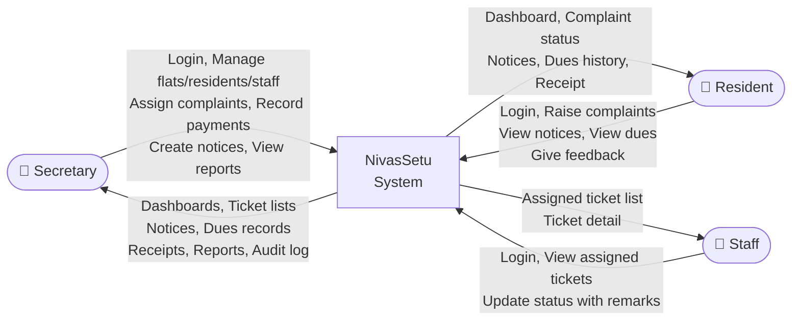
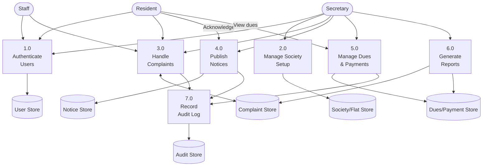
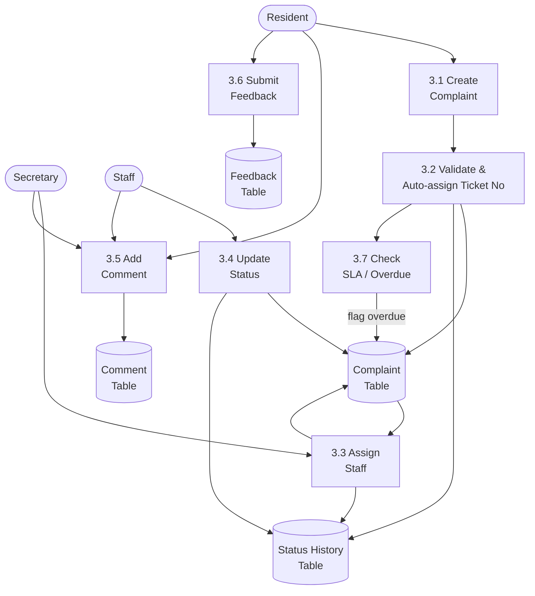
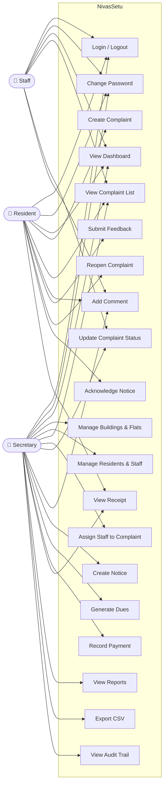
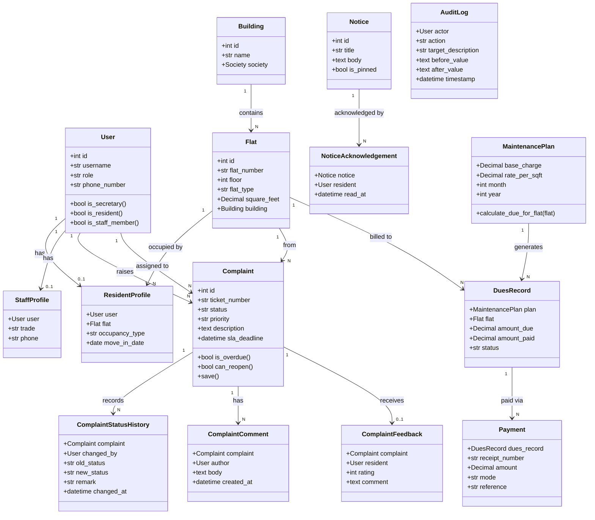
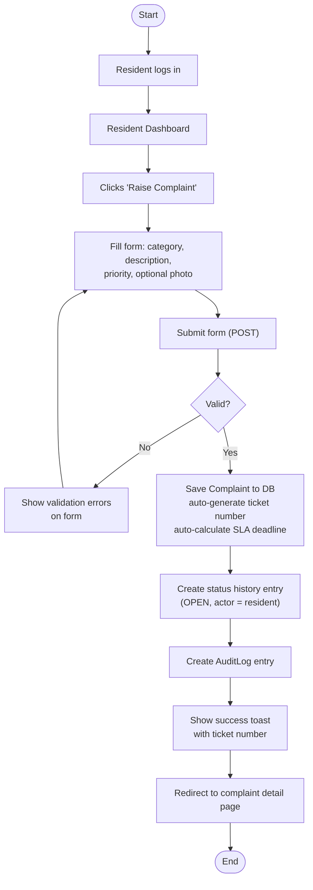
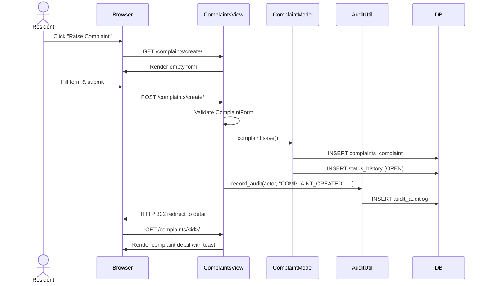
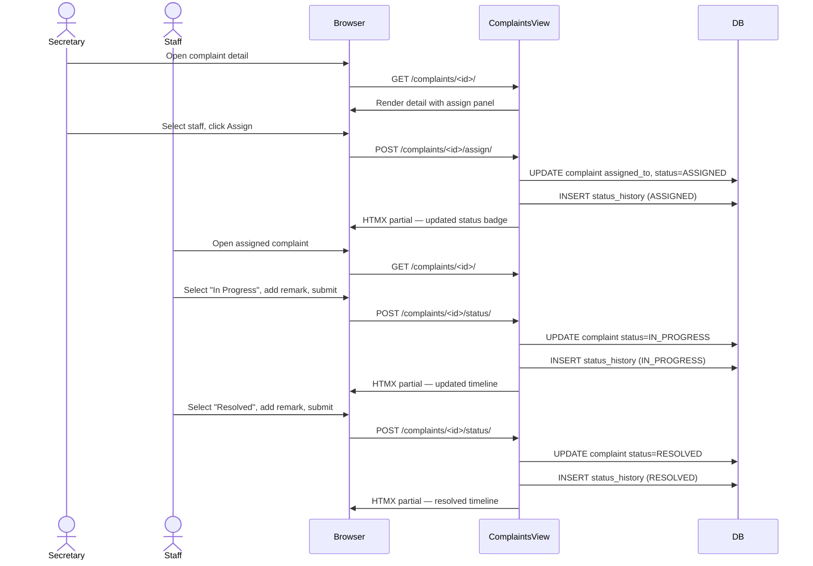
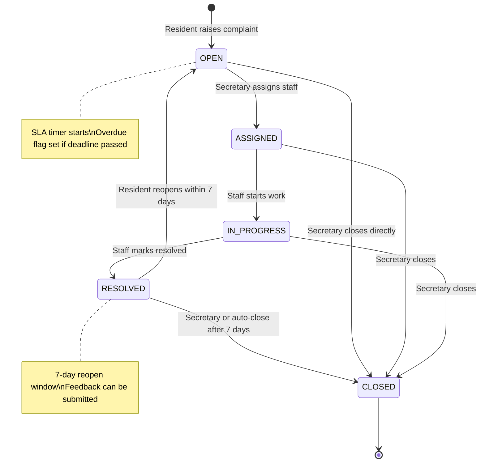

# Chapter 4 — System Design

**Project:** NivasSetu  **Version:** 1.0

---

## 4.1 Architecture Overview

NivasSetu follows a classic **3-tier web architecture**:

```
┌──────────────────────────────────────────────────────────┐
│  Presentation Tier (Browser)                             │
│  Django Templates + Tailwind CSS + HTMX + Chart.js       │
└─────────────────────────┬────────────────────────────────┘
                          │  HTTP / HTMX (partial)
┌─────────────────────────▼────────────────────────────────┐
│  Application Tier (Django)                               │
│  URLs → Views → Forms → Models (ORM) → Serializers       │
│  Middleware: Auth, CSRF, Messages, Session               │
└─────────────────────────┬────────────────────────────────┘
                          │  SQL queries via ORM
┌─────────────────────────▼────────────────────────────────┐
│  Data Tier                                               │
│  SQLite (dev) / PostgreSQL (prod)                        │
└──────────────────────────────────────────────────────────┘
```

**Key design decisions:**
- HTMX delivers partial HTML fragments (e.g., filtered ticket table) without JSON APIs
- No JavaScript framework; interactivity comes from HTMX + Alpine.js-style `x-data` toggle for dark mode
- One Django project, eight apps, each owns its models/views/urls/templates

---

## 4.2 Context Diagram (DFD Level 0)



---

## 4.3 DFD Level 1 — System Processes



---

## 4.4 DFD Level 2 — Complaint Process (Process 3.0)



---

## 4.5 Use Case Diagram



---

## 4.6 Class Diagram (Core Models)



---

## 4.7 Activity Diagram — Raise a Complaint



---

## 4.8 Sequence Diagram — Raise a Complaint



---

## 4.9 Sequence Diagram — Secretary Assigns Staff and Staff Resolves



---

## 4.10 State Diagram — Complaint Lifecycle



