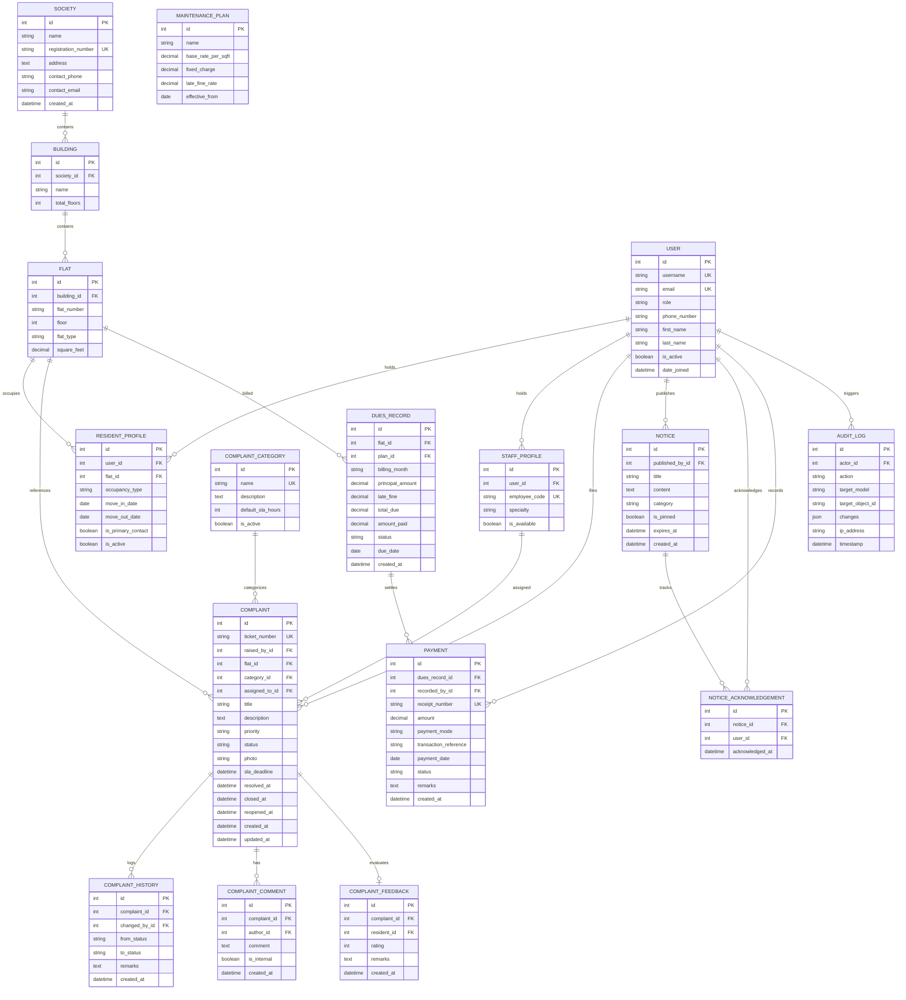

# NivasSetu — Project Plan & System Specification
**Project**: NivasSetu (Housing Society Complaints & Maintenance Dues Tracker)  
**Curriculum**: S.Y.B.Sc. Computer Science Semester III Mini Project (CS-231-FP)  
**Target Architecture**: Python 3.11/3.14 + Django 5/6 + SQLite (Dev) / PostgreSQL (Prod) + HTMX + Tailwind CSS  

---

## 1. Entities & 3NF Relational Model



---

## 2. Page & Screen Directory

| URL Route | Screen Name | Permitted Roles | Purpose |
|---|---|---|---|
| `/` | Landing / Showcase Page | Public / All | Problem overview, feature showcase, 1-click demo logins |
| `/accounts/login/` | Sign In | Public / All | Role authentication and automated role-based routing |
| `/accounts/profile/` | Profile & Contacts | All (Authenticated) | Edit user name, phone number, view current flat |
| `/accounts/change-password/` | Change Password | All (Authenticated) | Change account password |
| `/dashboard/` | Core Dispatcher | All (Authenticated) | Dispatches to Secretary, Resident, or Staff dashboard |
| `/dashboard/secretary/` | Secretary Dashboard | Secretary | Overview KPI cards (active complaints, SLA overdue, dues collected) |
| `/dashboard/resident/` | Resident Dashboard | Resident | Personal active tickets, dues status, latest notice alerts |
| `/dashboard/staff/` | Staff Dashboard | Staff | Technician worklist queue, quick resolution actions |
| `/society/flats/` | Flats & Wings Roster | Secretary | Wing filter, carpet area list, occupancy indicators |
| `/society/flats/add/` | Add Flat Unit | Secretary | Register new flat with wing, floor, sq.ft |
| `/society/residents/` | Resident Directory | Secretary | Owner/tenant records, phone numbers, staff roster |
| `/society/residents/assign/`| Assign Flat Occupancy | Secretary | Form to map a user account to a flat unit |
| `/complaints/` | Complaints Directory | All (Role filtered) | Multi-facet filter (status, priority, category) + HTMX search |
| `/complaints/new/` | Raise Grievance Form | Resident, Secretary | Lodging complaint with category, priority, photo |
| `/complaints/<ticket_no>/` | Ticket Detail & Timeline | All Permitted | State timeline, HTMX comment thread, staff assignment |
| `/complaints/<ticket_no>/feedback/` | Ticket Feedback Form | Resident | 1-to-5 star rating and service review post-resolution |
| `/notices/` | Notice Board | All Roles | Categorized notices, pinned alert banner, HTMX acknowledgement |
| `/notices/create/` | Publish Notice | Secretary | Broadcast new society announcement with pin toggle |
| `/dues/` | Maintenance Ledger | Secretary | Overall society billing table, pending default flags |
| `/dues/my-dues/` | Resident Dues Ledger | Resident | Flat dues breakdown, unpaid alert, receipt links |
| `/dues/generate/` | Generate Monthly Dues | Secretary | Batch generates monthly bills across all flats |
| `/dues/record/<id>/` | Record Payment Modal | Secretary, Resident | Form for Cash / UPI reference / Cheque entry |
| `/dues/receipt/<receipt_no>/` | Payment Receipt | Secretary, Resident | Print-ready HTML society voucher layout |
| `/reports/` | Reports & Analytics | Secretary | Average resolution time, SLA compliance, dues collection, CSV exports |
| `/audit/` | Audit Trail | Secretary | Centralized immutable audit logs of status and financial updates |

---

## 3. Directory & Folder Tree

```
NivasSetu/
├── config/
│   ├── __init__.py
│   ├── asgi.py
│   ├── wsgi.py
│   ├── urls.py
│   └── settings/
│       ├── __init__.py
│       ├── base.py
│       ├── dev.py
│       └── prod.py
├── apps/
│   ├── accounts/              # Custom User, Roles, Auth, Profiles
│   ├── society/               # Society, Building, Flat, Occupancy, Staff
│   ├── complaints/            # Grievance Lifecycle, SLA, Comments, History
│   ├── notices/               # Announcements, Pinning, Acknowledgements
│   ├── dues/                  # Maintenance Plans, Ledger, Payments, Receipts
│   ├── reports/               # Analytics, Charts, CSV Exports
│   ├── audit/                 # Audit Logging Signal Handler & Models
│   └── core/                  # Landing, Dispatcher, Context Processors
├── templates/
│   ├── base.html              # Responsive shell, mobile bottom nav, desktop sidebar, dark mode
│   ├── components/            # Partials: navbar, sidebar, mobile_nav, toast, status_badge
│   ├── accounts/              # login.html, profile.html, change_password.html
│   ├── society/               # flat_list.html, flat_form.html, resident_list.html, assign_resident.html
│   ├── complaints/            # complaint_list.html, complaint_detail.html, create_complaint.html
│   ├── notices/               # notice_list.html, notice_form.html
│   ├── dues/                  # dues_list.html, my_dues.html, record_payment.html, receipt.html
│   ├── reports/               # overview.html, charts.html
│   └── core/                  # landing.html, secretary_dashboard.html, resident_dashboard.html, staff_dashboard.html
├── static/
│   ├── css/
│   ├── js/
│   └── images/
├── docs/
│   ├── PLAN.md                # Master plan and system specification (Stage 1)
│   ├── 01_Preliminary_Investigation.md
│   ├── 02_SRS.md
│   ├── 03_Database_Design.md
│   ├── 04_System_Design.md
│   ├── 05_IO_Design.md
│   ├── 06_Testing.md
│   ├── 07_Conclusion.md
│   ├── TRACEABILITY.md
│   └── VIVA_NOTES.md
├── tests/
│   ├── conftest.py
│   ├── test_accounts.py
│   ├── test_society.py
│   ├── test_complaints.py
│   ├── test_notices.py
│   ├── test_dues.py
│   └── test_reports.py
├── manage.py
├── requirements.txt
├── .env.example
├── THIRD_PARTY.md
├── Makefile
└── README.md
```

